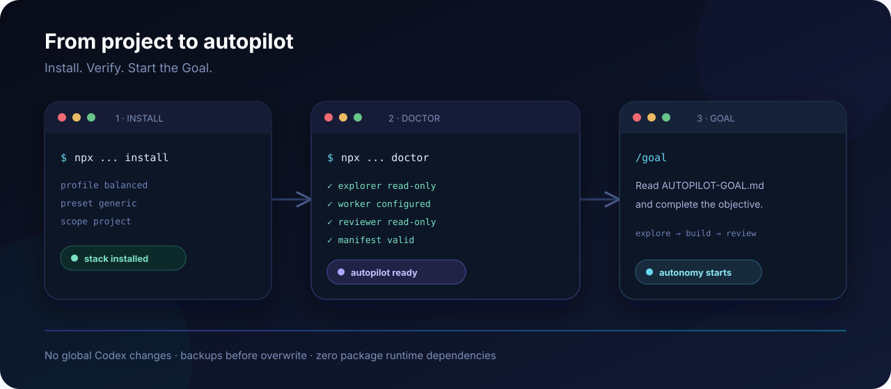

<p align="center">
  
</p>

<p align="center">
  <a href="README.md">English</a> · <strong>Español</strong>
</p>

# Codex Autopilot Kit

<p align="center">
  <strong>Mantén Codex. Añade Autopilot.</strong><br />
  Convierte un proyecto existente de Codex en un flujo multiagente seguro y aislado por proyecto.
</p>

<p align="center">
  <a href="../../actions/workflows/ci.yml"></a>
  <a href="LICENSE"></a>
  <a href="docs/SAFETY.md"></a>
  <a href="package.json"></a>
</p>

Codex Autopilot Kit instala una pila `.codex/` probada y contratos Goal reutilizables dentro de un repositorio existente. Un supervisor planifica y evalúa mientras subagentes especializados exploran, implementan, prueban y revisan de forma independiente.

No pretende reemplazar Codex, crear otro IDE ni convertirse en una plataforma pesada de orquestación. Es una capa de autopiloto pequeña y reversible para quienes ya quieren trabajar con Codex.

> Estrategia predeterminada: **Supervisor (tú eliges) → Explorer Luna Medium → Worker Luna High → Reviewer Luna High**, con concurrencia 1 por defecto.

## Inicio recomendado: wizard interactivo

Desde la raíz del proyecto objetivo:

```bash
npx --yes github:crunaldo/codex-autopilot-kit init --target .
```

El wizard permite elegir:

- **preset**: `generic`, `frontend-visual` o `backend`;
- **profile**: `economy`, `balanced` o `quality`;
- **concurrency**: `1`, `2` o `3`.

Antes de escribir cualquier archivo muestra un resumen completo y pide confirmación. La concurrencia `1` es la opción conservadora recomendada.

Para CI, scripts o instalación realizada por otro agente:

```bash
npx --yes github:crunaldo/codex-autopilot-kit init \
  --target . \
  --preset generic \
  --profile balanced \
  --concurrency 1 \
  --yes
```

Todo el wizard utiliza únicamente módulos estándar de Node.js. El paquete mantiene **0 dependencias de runtime**.

## Inspecciona antes de instalar

### Dry run

```bash
npx --yes github:crunaldo/codex-autopilot-kit install \
  --target . \
  --profile balanced \
  --preset generic \
  --concurrency 1 \
  --dry-run
```

El preview clasifica cada archivo como:

```text
CREATE     archivo nuevo
REPLACE    archivo existente que cambiaría
UNCHANGED  archivo que ya coincide
UPDATE     .gitignore si necesita la regla de backups
```

No escribe archivos, no crea backups y nunca toca `~/.codex`.

El wizard también acepta `--dry-run`:

```bash
npx --yes github:crunaldo/codex-autopilot-kit init \
  --target . \
  --preset frontend-visual \
  --profile balanced \
  --concurrency 1 \
  --yes \
  --dry-run
```

### Diff

Para ver exactamente qué cambiaría:

```bash
npx --yes github:crunaldo/codex-autopilot-kit diff --target .
```

Si el kit ya está instalado, `diff` usa por defecto el preset, profile y concurrencia actuales. También puedes comparar contra otra configuración sin escribir nada:

```bash
npx --yes github:crunaldo/codex-autopilot-kit diff \
  --target . \
  --profile quality \
  --preset backend \
  --concurrency 2
```

## Flujo visual rápido

<p align="center">
  
</p>

El camino corto es: configura con `init`, inspecciona con `--dry-run` o `diff`, instala, ejecuta `doctor` y luego inicia el Goal en un chat nuevo de Codex.

## Arquitectura

<p align="center">
  
</p>

Los roles se separan intencionalmente:

- **Supervisor** — planificación, evaluación, escalamiento y decisión final.
- **Explorer** — descubrimiento puntual en solo lectura.
- **Worker** — implementación, debugging y pruebas.
- **Reviewer** — revisión final independiente en solo lectura.

Explorer y Reviewer no necesitan permisos de escritura; Worker recibe la tarea concreta; el Supervisor conserva la decisión de continuar, corregir, marcar PASS o declarar BLOCKED.

## Qué optimiza

| Principio | Enfoque del kit |
|---|---|
| Mantener la herramienta existente | Añade estructura **a Codex** en lugar de reemplazarlo |
| Aislamiento | La configuración vive dentro del repositorio |
| Delegación predecible | Roles explícitos Explorer / Worker / Reviewer |
| Autonomía conservadora | Concurrencia 1 por defecto |
| Instalación inspeccionable | `init`, `--dry-run`, `diff`, backups y manifest |
| Ejecución consciente del costo | Supervisor fuerte + subagentes acotados |
| Flujos reutilizables | Goal presets especializados |
| Bajo peso operativo | Cero dependencias de runtime y sin servicios ocultos |

## Posicionamiento

Codex Autopilot Kit es deliberadamente más pequeño que una plataforma completa de agentes u orquestación. Está pensado para quienes ya usan Codex y quieren añadir autonomía multiagente sin sustituir su entorno.

| Herramienta | Enfoque típico |
|---|---|
| **Codex Autopilot Kit** | Añadir autonomía multiagente estructurada a un proyecto Codex existente |
| Ralph Orchestrator | Flujos más amplios de orquestación autónoma |
| OpenHands | Plataforma completa de agentes y entornos de ejecución |
| OpenCode | Experiencia independiente de agente de programación |
| Open Ralph Wiggum | Loop iterativo ligero sobre agentes existentes |
| Awesome Agent Orchestrators | Directorio de referencia y descubrimiento |

El objetivo no es sustituir esas categorías. Es hacer que un proyecto Codex existente sea más autónomo sin tomar control del flujo completo.

## Qué instala

```text
.codex/
  config.toml
  agents/
    explorer.toml
    worker.toml
    reviewer.toml
  autopilot-kit.json

AUTOPILOT-GOAL.md
```

Los archivos administrados se respaldan antes de ser reemplazados. Una instalación que ya coincide es idempotente: no reescribe archivos ni crea backups innecesarios.

## Instalación directa

El comando de bajo nivel sigue disponible:

```bash
npx --yes github:crunaldo/codex-autopilot-kit install \
  --target . \
  --profile balanced \
  --preset generic \
  --concurrency 1
```

Para frontend/visual:

```bash
npx --yes github:crunaldo/codex-autopilot-kit install \
  --target . \
  --profile balanced \
  --preset frontend-visual \
  --concurrency 1
```

Si existe un `.codex/config.toml` no administrado, la instalación normal se detiene. Usa primero `diff` o `--dry-run`; `--force` solo debe usarse cuando realmente quieras respaldarlo y sustituir los paths administrados.

## Verificación

```bash
npx --yes github:crunaldo/codex-autopilot-kit doctor --target .
```

Doctor valida archivos requeridos, UTF-8 estricto, registro de roles, modelos, Explorer/Reviewer en solo lectura, bloqueo de agentes anidados, concurrencia y manifest.

Salida consumible por CI/agentes:

```bash
npx --yes github:crunaldo/codex-autopilot-kit doctor --target . --json
```

El JSON incluye `schemaVersion`, `command`, `pass`, `target`, `kitVersion` y los checks individuales.

## Estado

```bash
npx --yes github:crunaldo/codex-autopilot-kit status --target .
```

También en JSON:

```bash
npx --yes github:crunaldo/codex-autopilot-kit status --target . --json
```

Cuando el kit no está instalado, el modo JSON devuelve un objeto estructurado con `installed: false` y código de salida `2`.

## Iniciar un Goal autónomo

Después de instalar o actualizar, abre un **chat nuevo de Codex** para recargar la configuración local. Selecciona tu supervisor y usa:

```text
/goal Lee AUTOPILOT-GOAL.md y completa de forma autónoma el objetivo siguiente. Respeta sus roles, reglas de seguridad, condiciones de parada y verificaciones. No esperes instrucciones mías entre iteraciones salvo que estés realmente BLOCKED.

OBJETIVO:
<describe aquí el resultado concreto>
```

En Goals largos define criterios PASS/FAIL medibles en lugar de instrucciones vagas como “sigue mejorando”.

## Profiles

| Profile | Explorer | Worker | Reviewer | Uso recomendado |
|---|---:|---:|---:|---|
| `economy` | medium | medium | high | trabajo repetitivo o bien acotado |
| `balanced` | medium | high | high | **predeterminado; trabajo real de proyecto** |
| `quality` | high | high | high | repos difíciles con mayor necesidad de exploración |

Ningún profile activa `max` automáticamente.

## Goal presets

- `generic` — tareas generales de software.
- `frontend-visual` — DISCOVER → EVIDENCE → BUILD → CAPTURE → COMPARE → FIX → VERIFY.
- `backend` — inspección → implementación → unit/integration tests → contract checks → review.

## Comandos

```text
codex-autopilot init       Wizard de configuración e instalación
codex-autopilot install    Instalar/actualizar la pila del proyecto
codex-autopilot diff       Comparar estado actual con configuración deseada
codex-autopilot doctor     Validar archivos, roles y manifest
codex-autopilot status     Mostrar profile/preset/concurrencia/versión
codex-autopilot uninstall  Eliminar archivos administrados; backup opcional
codex-autopilot print-goal Imprimir un Goal preset
```

Ayuda:

```bash
npx --yes github:crunaldo/codex-autopilot-kit --help
```

## Modelo de seguridad

El kit es deliberadamente conservador:

- solo modifica el proyecto objetivo;
- nunca modifica `~/.codex`;
- crea backups antes de reemplazar archivos administrados;
- no hace commit ni push;
- no instala paquetes dentro del proyecto objetivo;
- no levanta servicios ocultos;
- concurrencia 1 por defecto;
- Explorer y Reviewer son solo lectura;
- `--dry-run` y `diff` permiten inspección sin escritura.

Consulta [SAFETY.md](docs/SAFETY.md) antes de ejecutar Goals desatendidos en repositorios valiosos.

## Supervisor

El kit no fuerza el modelo padre. Selecciónalo en Codex al comenzar la ejecución.

Con un bridge compatible, el patrón probado ha sido:

```text
GPT-5.6 Sol (Web) High  -> supervisor
GPT-6 Luna Medium       -> explorer
GPT-6 Luna High         -> worker
GPT-6 Luna High         -> reviewer
```

El bridge `codex-chatgpt-web` es opcional, externo al proyecto y nunca se instala silenciosamente. Consulta [MODEL_STRATEGY.md](docs/MODEL_STRATEGY.md) y [BRIDGE_SETUP.md](docs/BRIDGE_SETUP.md).

## Documentación

- [Primeros pasos](docs/GETTING_STARTED.md)
- [Arquitectura](docs/ARCHITECTURE.md)
- [Estrategia de modelos](docs/MODEL_STRATEGY.md)
- [Goal playbook](docs/GOAL_PLAYBOOK.md)
- [Seguridad](docs/SAFETY.md)
- [Troubleshooting](docs/TROUBLESHOOTING.md)
- [Bridge opcional](docs/BRIDGE_SETUP.md)
- [Field notes](docs/field-notes/2026-10.md)

## Estado del proyecto

Consulta [ROADMAP.md](ROADMAP.md) para las siguientes mejoras.

Codex Autopilot Kit es un proyecto comunitario y no está afiliado ni respaldado por OpenAI. Los nombres de productos y marcas pertenecen a sus respectivos titulares.

## Licencia

MIT — consulta [LICENSE](LICENSE).
