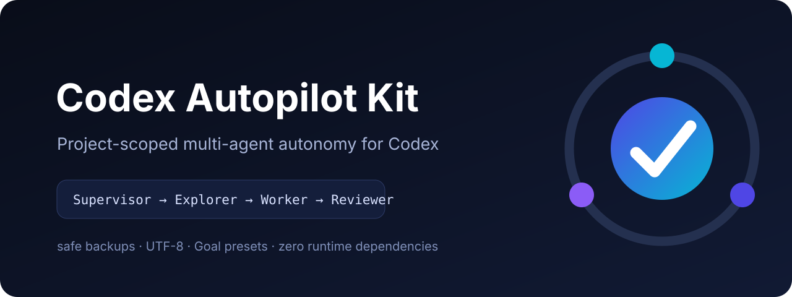
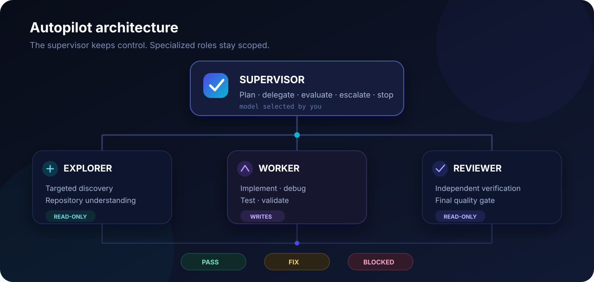

<p align="center">
  
</p>

<p align="center"><a href="README.md">English</a> · <strong>Español</strong></p>

# Codex Autopilot Kit

<p align="center">
  <strong>Mantén Codex. Añade Autopilot.</strong><br />
  Convierte un proyecto existente de Codex en un flujo multiagente seguro y aislado por proyecto.
</p>

<p align="center">
  <a href="../../actions/workflows/ci.yml"></a>
  <a href="https://www.npmjs.com/package/codex-autopilot-kit"></a>
  <a href="LICENSE"></a>
  <a href="package.json"></a>
</p>

Codex Autopilot Kit instala una pila `.codex/` probada y contratos Goal reutilizables dentro de un repositorio existente. Un supervisor planifica y evalúa mientras subagentes especializados exploran, implementan, prueban y revisan de forma independiente.

No sustituye Codex, no crea otro IDE y no añade una plataforma pesada de orquestación. Es una capa de autopiloto ligera para quienes ya usan Codex y quieren más autonomía sin reemplazar su flujo.

> Estrategia predeterminada: **Supervisor (tú eliges) → Explorer Luna Medium → Worker Luna High → Reviewer Luna High**, con concurrencia 1 por defecto.

## Configurador visual

Configura la pila sin memorizar flags:

**https://crunaldo.github.io/codex-autopilot-kit/**

Elige preset de Goal, profile de ejecución y concurrencia máxima. El configurador muestra los roles resultantes, niveles de razonamiento, uso relativo de modelos, archivos administrados y los comandos exactos de preview e instalación. La URL conserva la configuración para poder compartirla.

El configurador es estático y funciona del lado del cliente. No recibe el contenido de tu repositorio ni credenciales.

## Inicio rápido

Desde la raíz del proyecto objetivo:

```bash
npx --yes codex-autopilot-kit init --target .
```

O previsualiza una configuración completa antes de escribir:

```bash
npx --yes codex-autopilot-kit init \
  --target . \
  --preset generic \
  --profile balanced \
  --concurrency 1 \
  --yes \
  --dry-run
```

Después instala:

```bash
npx --yes codex-autopilot-kit init \
  --target . \
  --preset generic \
  --profile balanced \
  --concurrency 1 \
  --yes
```

GitHub sigue siendo la fuente canónica y puede usarse directamente como fallback:

```bash
npx --yes github:crunaldo/codex-autopilot-kit init --target .
```

## Qué instala

```text
.codex/
  config.toml
  agents/
    explorer.toml
    worker.toml
    reviewer.toml
  autopilot-kit.json

AUTOPILOT-GOAL.md
```

Los conflictos administrados se respaldan antes de ser reemplazados. Para el TOML existente del proyecto, `--config-strategy merge` conserva la configuración ajena al kit y se detiene antes de escribir si hay conflictos con valores administrados. Una reinstalación que ya coincide es idempotente y no crea backups innecesarios.

## Inspecciona antes de instalar

Dry run:

```bash
npx --yes codex-autopilot-kit install \
  --target . \
  --profile balanced \
  --preset generic \
  --concurrency 1 \
  --dry-run
```

Diff exacto:

```bash
npx --yes codex-autopilot-kit diff --target .
```

Diff consumible por máquinas:

```bash
npx --yes codex-autopilot-kit diff --target . --json
```

El preview clasifica los archivos como `CREATE`, `REPLACE`, `MERGE`, `CONFLICT` o `UNCHANGED`, e informa por separado si `.gitignore` necesita actualización. `--dry-run` y `diff` no escriben archivos.

## Verifica

```bash
npx --yes codex-autopilot-kit doctor --target .
```

Para CI y agentes:

```bash
npx --yes codex-autopilot-kit doctor --target . --json
npx --yes codex-autopilot-kit status --target . --json
```

Doctor valida archivos requeridos, UTF-8 estricto, registro de roles, modelos esperados, Explorer/Reviewer en solo lectura, agentes anidados deshabilitados, concurrencia y manifest local.

## Arquitectura

<p align="center">
  
</p>

- **Supervisor** — planificación, delegación, evaluación, escalamiento y decisión final.
- **Explorer** — descubrimiento puntual en solo lectura.
- **Worker** — implementación, debugging, pruebas y validación.
- **Reviewer** — revisión final independiente en solo lectura.

El usuario selecciona el modelo Supervisor; el kit configura los roles locales del proyecto.

## Profiles

| Profile | Explorer | Worker | Reviewer | Uso recomendado |
|---|---:|---:|---:|---|
| `economy` | medium | medium | high | trabajo repetitivo o bien acotado |
| `balanced` | medium | high | high | **predeterminado; trabajo real de proyecto** |
| `quality` | high | high | high | repositorios difíciles o con mucha exploración |

Ningún profile activa razonamiento máximo automáticamente.

## Goal presets

- `generic` — tareas generales de software.
- `frontend-visual` — DISCOVER → EVIDENCE → BUILD → CAPTURE → COMPARE → FIX → VERIFY.
- `backend` — inspección → implementación → unit/integration tests → contract checks → review.

## Comandos

```text
codex-autopilot init       Wizard de configuración e instalación
codex-autopilot install    Instalar/actualizar la pila del proyecto
codex-autopilot diff       Comparar estado actual con configuración deseada
codex-autopilot doctor     Validar archivos, roles, concurrencia y manifest
codex-autopilot status     Mostrar profile/preset/concurrencia/versión
codex-autopilot presets    Listar presets de Goal disponibles
codex-autopilot record     Guardar un receipt local
codex-autopilot runs       Listar receipts locales
codex-autopilot readiness  Puntuar señales observables del proyecto
codex-autopilot benchmarks Resumir benchmarks emparejados
codex-autopilot uninstall  Eliminar archivos administrados; restauración opcional
codex-autopilot print-goal Imprimir un Goal preset
```

## Receipts locales y readiness

Después de un Goal, registra su resultado y los conteos de roles observados manualmente. El comando crea un archivo JSON en <code>.autopilot/runs/</code>; no captura el texto del Goal, tokens ni rutas de archivos, y no transmite datos por la red.

~~~bash
npx --yes codex-autopilot-kit record --target . --preset frontend-visual --profile balanced --explorer-calls 1 --worker-calls 3 --reviewer-calls 1 --result PASS --tests PASS --duration-seconds 510 --files-changed 4
npx --yes codex-autopilot-kit runs --target . --json
npx --yes codex-autopilot-kit readiness --target . --json
~~~

Readiness es una lista transparente basada en archivos y estado de Git; no mide la inteligencia del modelo ni garantiza la calidad de una tarea. Los benchmarks requieren IDs de caso y pareja, el mismo preset/profile y un receipt por modo. El resumen es descriptivo y no afirma causalidad. El repositorio incluye tres tareas iniciales fijas en la [suite de benchmarks](benchmarks/README.md). Consulta también [Telemetría](docs/TELEMETRY.md) y [Protocolo de benchmarks](docs/BENCHMARKS.md).

## Iniciar un Goal autónomo

Después de instalar o actualizar, abre un **chat nuevo de Codex** para recargar la configuración local. Selecciona el Supervisor y usa el contrato instalado `AUTOPILOT-GOAL.md`:

```text
/goal Lee AUTOPILOT-GOAL.md y completa de forma autónoma el objetivo siguiente. Respeta sus roles, reglas de seguridad, verificaciones y contrato PASS/BLOCKED. No esperes instrucciones mías entre iteraciones salvo que estés realmente BLOCKED.

OBJETIVO:
<tu objetivo concreto>
```

## Modelo de seguridad

El kit es deliberadamente conservador:

- solo modifica el proyecto objetivo;
- nunca modifica `~/.codex`;
- crea backups antes de reemplazar archivos administrados;
- no hace commit ni push;
- no instala paquetes dentro del proyecto objetivo;
- no levanta servicios ocultos;
- concurrencia 1 por defecto;
- Explorer y Reviewer son solo lectura;
- `--dry-run` y `diff` son solo inspección.

Consulta [SAFETY.md](docs/SAFETY.md) antes de ejecutar Goals desatendidos en repositorios valiosos.

## Documentación

- [Configurador visual](https://crunaldo.github.io/codex-autopilot-kit/)
- [Primeros pasos](docs/GETTING_STARTED.md)
- [Instalación para agentes](INSTALL_FOR_AGENTS.md)
- [Arquitectura](docs/ARCHITECTURE.md)
- [Estrategia de modelos](docs/MODEL_STRATEGY.md)
- [Goal playbook](docs/GOAL_PLAYBOOK.md)
- [Telemetría](docs/TELEMETRY.md)
- [Protocolo de benchmarks](docs/BENCHMARKS.md)
- [Pruebas de compatibilidad con Codex](docs/CODEX_COMPATIBILITY.md)
- [Seguridad](docs/SAFETY.md)
- [Troubleshooting](docs/TROUBLESHOOTING.md)
- [Distribución](docs/DISTRIBUTION.md)
- [Roadmap](ROADMAP.md)

## Estado del proyecto

La versión v1.0.0 consolida como estable la configuración y el CLI por proyecto, el manifiesto estable, los recibos locales de ejecución, las comprobaciones de readiness y los resúmenes de benchmarks. Instala la versión vigente desde npm con `npm install -g codex-autopilot-kit`. Consulta [CHANGELOG.md](CHANGELOG.md) y [ROADMAP.md](ROADMAP.md) para conocer el lanzamiento y las limitaciones de los benchmarks.

Codex Autopilot Kit es un proyecto comunitario y no está afiliado ni respaldado por OpenAI. Los nombres de productos y marcas pertenecen a sus respectivos titulares.

## Licencia

MIT — consulta [LICENSE](LICENSE).
